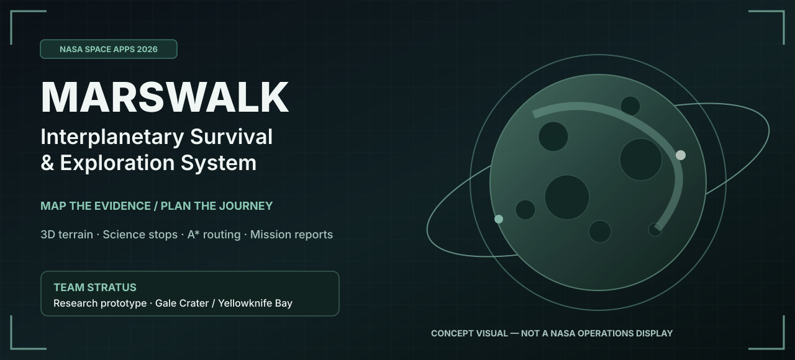
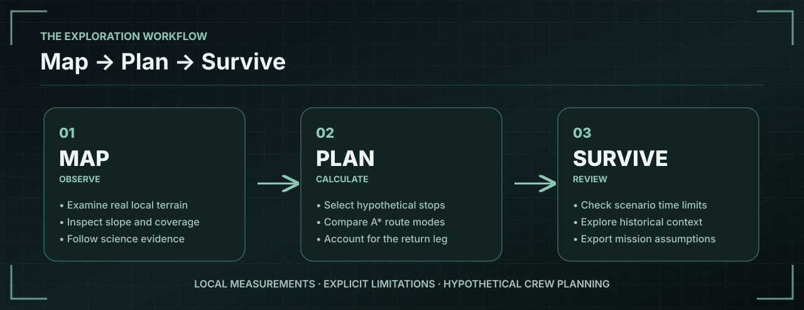
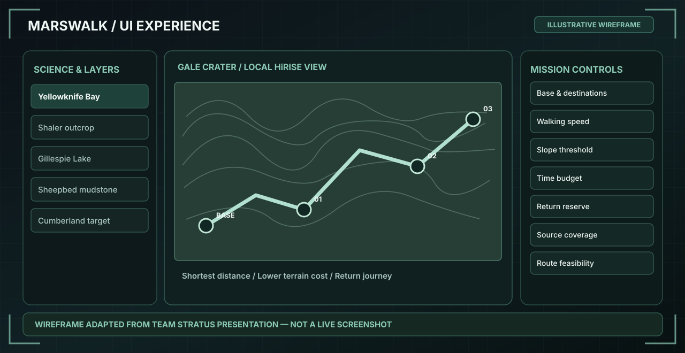
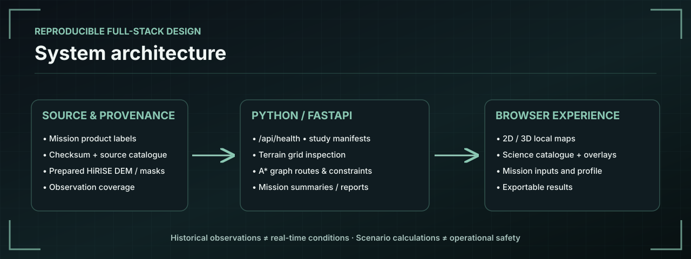
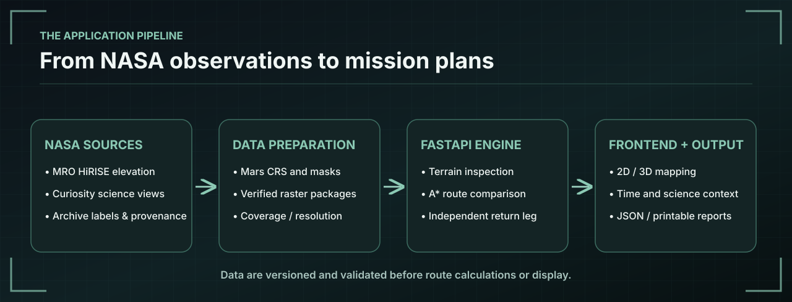
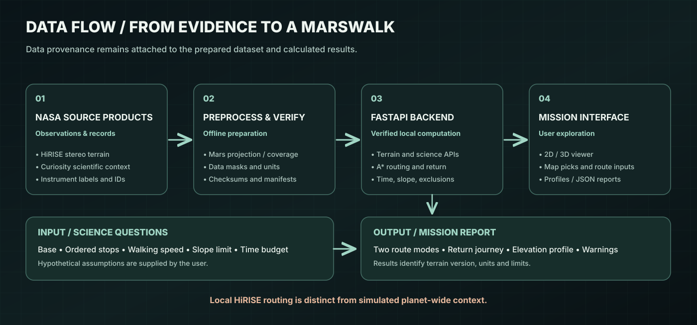
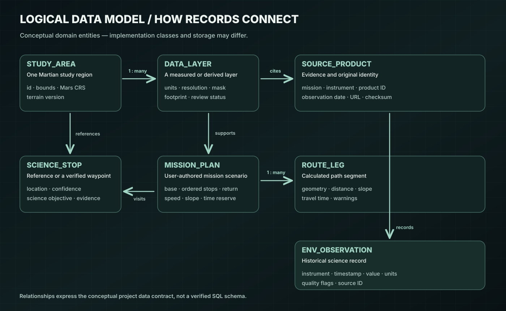

<p align="center">
  
</p>

<h1 align="center">MARSWALK <sub>⟡</sub> MARS GUARD</h1>
<p align="center"><strong>Interplanetary Survival &amp; Exploration System</strong><br />From Mars observations to explainable, reproducible exploration plans.</p>

<p align="center">
  
  
  
  
  
</p>

<p align="center">
  <a href="https://marswalk-gale-crater.onrender.com/"><strong>🌐 OPEN LIVE MARSWALK WEBSITE</strong></a>
  &nbsp; · &nbsp;
  <a href="https://marswalk-gale-crater.onrender.com/api/health">Backend API Status</a>
</p>

<p align="center"><sub>Previously reported Render deployment URL. Current uptime has not been independently verified.</sub></p>

<p align="center">
  <a href="#-mission">Mission</a> ·
  <a href="#-inside-the-system">Features</a> ·
  <a href="#-technical-architecture">Architecture</a> ·
  <a href="#data-flow-diagram">Data flow</a> ·
  <a href="#logical-data-model">Data model</a> ·
  <a href="#-scientific-data">Datasets</a> ·
  <a href="#-run-marswalk">Run locally</a> ·
  <a href="#-verification--scope">Verification</a> ·
  <a href="#-roadmap">Roadmap</a>
</p>

> [!IMPORTANT]
> **Scientific scope:** MARSWALK is a NASA Space Apps *research and educational prototype*, **not** an operational astronaut navigation or life-support system. Its local HiRISE terrain calculations are distinct from global illustrative models. The visual diagrams below are adapted from the team's presentation and illustrate our project story; they are **not independent proof** of actual measurements, site coordinates or astronaut safety.

---

## 🚀 Mission

**The question:** *How can a future crew explore a scientifically valuable part of Mars, understand the available observations, compare routes, and know which assumptions their plan depends on?*

**Our answer:** MARSWALK combines an interactive Martian map with a terrain-aware excursion planner, science evidence, environmental context and downloadable mission outputs in one interface.

- **Where?** Gale Crater, with a detailed study area near **Yellowknife Bay**—a region investigated by NASA's Curiosity rover for evidence of past water.
- **Why?** Make planetary observations usable during a hypothetical **Map → Plan → Survive** workflow.
- **How?** A browser interface backed by Python/FastAPI, a versioned HiRISE terrain grid, source catalogues and deterministic route algorithms.
- **What makes it different?** Route comparisons are paired with scientific source links, explicit return-time accounting and labels distinguishing *observed*, *derived*, *historical*, *simulated* and *unknown* information.

<p align="center"></p>
<p align="center"><sub>A vector illustration of Team STRATUS’s Map → Plan → Survive presentation storyline, not a NASA operations display.</sub></p>

### Three stages, one mission

| 🗺️ 01 — MAP | 🧭 02 — PLAN | 🛡️ 03 — SURVIVE |
|:--|:--|:--|
| Inspect local terrain, elevation, derived slope, science locations and source metadata. | Choose a hypothetical base and stops; compare routes and compute the return journey. | Review the time budget, exclusions, historical science context and labelled what-if scenarios. |

---

## 🧭 Explore MARSWALK your way

Pick an area to investigate — these links stay inside this README.

| 🛰️ Understand the science | 🧩 Explore engineering | 🚀 Try the project |
|:--|:--|:--|
| [NASA datasets](#-scientific-data) · [Data model](#logical-data-model) | [Architecture](#-technical-architecture) · [Data flow](#data-flow-diagram) | [Run with Docker](#-run-marswalk) · [API](#-api-at-a-glance) |

<details>
<summary><strong>▶ Open a sample Marswalk mission — seven steps</strong></summary>

1. Inspect the local **Yellowknife Bay** terrain and verify its coverage.
2. Choose a **hypothetical staging point** and science stops.
3. Set mobility assumptions: walking speed, slope limit and reserve.
4. Ask FastAPI for **Shortest Distance** and **Lower Terrain Cost**.
5. Compare profiles, route length and sampled slope.
6. Check the independent return leg and time budget.
7. Export the plan with source information and limitations.

This is an illustrative visitor walkthrough; operational astronaut safety is **not** certified.

</details>

---

## ✨ Inside the system

| Area | What visitors can explore | Important distinction |
|:--|:--|:--|
| **Local 2D/3D terrain** | Pan, zoom, rotate, inspect a HiRISE-derived elevation grid and view terrain profiles. | The detailed DEM covers a **small area**, not the entire crater. |
| **Global Mars explorer** | Browse major regions, context layers and planetary information cards. | Some global terrain, site scores and routes are **illustrative models**. |
| **Mission planner** | Place a base and ordered stops; configure walking speed, slope limit, dwell time and reserve. | Waypoints can be **hypothetical**; named outcrops need position verification. |
| **Two route modes** | **Shortest Distance** and **Lower Terrain Cost**, with route metrics and an independent return. | Lower terrain cost does **not** mean certified astronaut safety. |
| **Terrain inspection** | Examine supported elevation cells, slope, coverage gaps and elevation-versus-distance profiles. | Derived slope is not a separate satellite instrument. |
| **Science destinations** | Read about Yellowknife Bay, Shaler, Gillespie Lake, Sheepbed, drill targets, Gale Crater and Mount Sharp. | A scientific reference card is not automatically an exact local pin. |
| **Ancient-water evidence** | Explore published lake/stream and hydrated-mineral interpretations. | Ancient or mineral-bound water does **not** prove accessible liquid water today. |
| **Environment panels** | Review available historical atmospheric, radiation and resource context. | Historical summaries are **not** live local weather or high-resolution hazard fields. |
| **Scenario lab** | Experiment with delay, time budget, dust and other declared model assumptions. | Simulations are not forecasts or operational emergency guidance. |
| **Mission outputs** | Download structured plan data and printable reports. | Outputs should retain inputs, source versions and known limitations. |

### Product preview

<p align="center"></p>
<p align="center"><sub>Illustrative interface diagram adapted from the Team STRATUS presentation; not an actual deployment screenshot.</sub></p>

---

## 🏗️ Technical architecture

MARSWALK is structured around a reproducible data flow: NASA products and source records are prepared **before** interactive requests; the backend calculates routes; the frontend presents results and supporting evidence.

<p align="center"></p>

<details>
<summary><strong>View the presentation-inspired pipeline diagram</strong></summary>

<p align="center"></p>

This illustration is the **conceptual architecture**; counts of fully integrated NASA datasets require a separate manifest/coverage audit.

</details>

### Technology stack

| Layer | Technology / responsibility |
|:--|:--|
| **Frontend experience** | Browser-based HTML/CSS/JavaScript dashboard, React/Vite source components and 2D/3D rendering with Three.js/Canvas. Check build parity before replacing the packaged homepage. |
| **Backend** | **Python 3.12**, **FastAPI**, **Uvicorn**; API schemas, data catalogue, terrain inspection and report responses. |
| **Routing** | Deterministic **A\*** grid routing over valid local terrain cells; distance and terrain-cost modes. |
| **Planetary data** | HiRISE-derived DEM and imagery assets, per-product source metadata, coverage masks and additional science catalogue entries. |
| **Build and deployment** | Source archive checksum verification, **Docker** packaging and cloud-ready server binding to the configured `PORT`. |
| **Testing** | Python/Node test suites, manifest checks, local API smoke checks and planned full browser/hosted release verification. |

### Data-flow diagram

<p align="center">
  <a href="docs/assets/data-flow.svg" title="Open the full-size data-flow diagram">
    
  </a>
</p>

<details>
<summary><strong>🔎 Explore the data flow step by step</strong></summary>

1. **NASA source records:** collect product identities, observation dates, footprints and credits.
2. **Verify and prepare:** preserve Mars-specific map coordinates, masks, units and checksums.
3. **Calculate:** FastAPI serves terrain/science data and computes shortest-distance and lower-terrain-cost routes, including the return leg.
4. **Interact:** the browser displays only supported map layers and allows hypothetical base and science-stop selection.
5. **Explain and export:** deliver route metrics, source references, assumptions and uncertainty notes.

**Important:** Generated global terrain and scenario scores are separate from the locally measured HiRISE terrain.

</details>

[Open the full-size data-flow diagram](docs/assets/data-flow.svg)

### Main engineering components

| Component / function | Role |
|:--|:--|
| `Terrain.from_file(...)` | Loads and validates a prepared routing terrain package. |
| `Planner.plan(...)` | Calculates mission legs and route metrics using the declared terrain and constraints. |
| `restore_plan(...)` | Reloads an earlier plan and optionally recalculates it. |
| `great_circle_km(...)` | Computes regional/planetary spherical distance for the global context tools. |
| `score_site(...)` | Provides a **scenario** site-comparison index—not a NASA-certified landing score. |
| Dataset catalogue / manifest | Tracks availability, source IDs, units, observations and scientific limitations. |
| FastAPI endpoint layer | Exposes terrain inspection, science records, routes and report services to the browser. |

The exact current implementation is available after restoring the repository's application archive (see **Run MARSWALK** below).

---

## 🪐 Scientific data

### Local terrain: the measurable foundation

| Attribute | Detail |
|:--|:--|
| **Study area** | Yellowknife Bay / Gale Crater local terrain crop |
| **Instrument** | Mars Reconnaissance Orbiter (**MRO**) / **HiRISE** stereo DTM |
| **Terrain product** | `DTEEC_010573_1755_010639_1755_U01` |
| **Processed routing grid** | **587 × 880 cells** |
| **Grid spacing** | Approximately **2.02 metres per cell** |
| **Valid-grid coverage** | Approximately **93.94%**; other cells explicitly masked |
| **Coordinate principles** | Mars-specific projected metres; document latitude type and east-positive longitude conventions |
| **Scientific boundary** | Large or small surface hazards not resolved by the input DEM remain unknown |

**Source:** [HiRISE stereo terrain product — University of Arizona / NASA/JPL](https://www.uahirise.org/dtm/PSP_010573_1755). Numerical details above are from the supplied project's processed-terrain manifest; always use the manifest actually deployed with the release.

### Other NASA science and evidence

| Source | Intended use | What the README **does not** assume |
|:--|:--|:--|
| **MSL Curiosity** Mastcam/Navcam | Ground views and named geology stops | Not every science target is precisely mapped onto the local DEM. |
| **MGS MOLA** | Planetary elevation context | Global illustrative relief is not equivalent to a local validated MOLA routing grid. |
| **Mars Odyssey THEMIS** | Historical infrared/thermal context | A complete, calibrated THEMIS pixel field over this crop is **not automatically established**. |
| **MSL Curiosity REMS / RAD** | Historical environmental and radiation context | Summaries are not live forecasts or independently validated per-cell observations. |
| **MSL Curiosity DAN** | Hydrogen and water-related scientific evidence | Hydrogen-equivalent measurements do not confirm usable ice or liquid water. |
| **MRO CRISM** | Mineralogical context where products are processed and checked | A catalogue reference does not mean a calibrated raster is fully imported. |
| **Perseverance MEDA** | Jezero climate context | **Not valid as local Gale Crater weather**—keep geographically separate. |

**Evidence rule:** A displayed science layer should be labelled **observed**, **derived**, **historical**, **interpretation**, **simulation**, or **unavailable**, with product, date, units, resolution and spatial coverage available on request.

### Logical data model

<p align="center">
  <a href="docs/assets/data-model.svg" title="Open the full-size logical data model">
    
  </a>
</p>

<details>
<summary><strong>🔎 Explore the record relationships</strong></summary>

- A **StudyArea** contains multiple **DataLayers**, references **ScienceStops**, and supports user-created **MissionPlans**.
- A **DataLayer** cites one or more **SourceProducts** with instrument identity and provenance.
- A **MissionPlan** selects science stops and contains route legs for travel and return.
- A **SourceProduct** can support historical **EnvObservations** with dates, measurements, units and quality flags.
- A location marked *reference only* is **not** automatically a precisely registered waypoint.

The diagram is a conceptual data model, **not** a claim that all entities are stored in a production database.

</details>

[Open the full-size data-model diagram](docs/assets/data-model.svg)

| Record | Typical fields |
|:--|:--|
| **StudyArea** | Area ID, bounds, body model, Mars CRS, dataset version |
| **DataLayer** | Quantity, units, native/display scale, footprint, nodata, source IDs |
| **SourceProduct** | Mission, instrument, archive ID, observation time, URL, checksum |
| **ScienceStop** | Name, location/review status, science question, dwell time, evidence |
| **MissionPlan** | Base, ordered stops, exclusions, speed, slope limit, reserve, return destination |
| **RouteLeg / RouteResult** | Geometry, distance, ascent/descent, time, status and warnings |
| **EnvObservation** | Time/sol, instrument, value, units, quality flags, source |

*This is the conceptual domain model; class names and persisted schemas may differ in source.*

---

## 🧠 How route planning works

1. **Load valid terrain:** Read the local DEM grid, derived slopes and supported-data mask.
2. **Set the mission:** Choose hypothetical base, ordered stops and the return point.
3. **Apply hard rules:** Reject missing-data cells, excluded regions and cells beyond the chosen **scenario** slope threshold.
4. **Compare A\* paths:** Calculate a **Shortest Distance** path and a **Lower Terrain Cost** path using the same hard exclusions.
5. **Account for the whole mission:** Sum outward travel, science-stop dwell times, an independently computed return and the explicit reserve.
6. **Explain results:** Show path geometry, profiles, key terrain tradeoffs, budget status and incomplete-coverage warnings.

A route that meets this model's constraints is not a guarantee of safe footing or human survivability. The global exploration mode is separate from this local evidence-backed routing workflow.

---

## 🔌 API at a glance

The application exposes REST-style services; inspect the running `/docs` page for the authoritative endpoint list and schemas for your deployed version.

| Example endpoint | Purpose |
|:--|:--|
| `GET /api/health` | API and dataset readiness |
| `GET /api/study-areas` | Available prepared study areas |
| `GET /api/datasets` / `GET /api/layers` | Source catalogue and layer status |
| `GET /api/science-stops` | Scientific location/evidence catalogue |
| `GET /api/terrain/inspect?row=...&col=...` | Inspect a supported local grid cell |
| `POST /api/route-plans` | Calculate a local outward-and-return mission |
| `GET /api/environment/rems` | Available REMS historical context |
| `GET /api/radiation/rad` | Available RAD historical context |
| `GET /api/water-evidence` | Ancient-water/subsurface evidence catalogue |
| `POST /api/reports` | Request a printable mission report |

> [!NOTE]
> The current release may include additional endpoints for global context and ingestion. **Keep administrative ingestion disabled by default** on public deployments, protect write operations with server-side authentication and do not expose private tokens to the browser.

---

## ▶️ Run MARSWALK

The [GitHub repository](https://github.com/shriram1210/marswalk-gale-crater) currently distributes a **checksum-verified application archive** under `deployment/`, split into 32 Base64 files. This is a transport format, **not 32 separate scientific datasets**. The script `unpack.py` reconstructs the ordinary source tree in `application/`.

### Option A — Docker (recommended for the published repository)

Requirements: Git and Docker Engine / Docker Desktop.

```bash
git clone https://github.com/shriram1210/marswalk-gale-crater.git
cd marswalk-gale-crater

docker build -t marswalk-gale-crater .
docker run --rm -p 10000:10000 marswalk-gale-crater
```

Open **http://localhost:10000**. Use **http://localhost:10000/docs** for interactive API documentation or **http://localhost:10000/api/health** for the backend status.

The [Dockerfile](Dockerfile) validates and unpacks the source during its build stage, installs the packaged Python dependency lockfile and launches `marswalk.production:app` under an unprivileged user. It respects the hosting provider's `PORT` environment variable.

### Option B — Review the actual source files

```bash
python unpack.py
cd application
```

The unpack operation verifies the expected **SHA-256 checksum** before extraction. The restored `application/` directory contains the normal Python backend, UI source/assets, configuration, tests and scientific provenance. Refer to its release notes and requirements before launching it outside Docker.

<details>
<summary><strong>What is in the GitHub repository?</strong></summary>

```text
marswalk-gale-crater/
├── README.md                 ← This project guide
├── Dockerfile                ← Reproducible cloud/container startup
├── unpack.py                 ← Checksum-verified restore script
├── deployment_tuning.py     ← Deployment-specific runtime tuning
├── deployment/
│   └── payload-*.b64        ← Packed application source (32 parts)
├── local_validation.json     ← Packaged local smoke-check metadata
├── docs/
│   └── assets/               ← Project/presentation illustrations
└── application/              ← Generated locally by unpack.py
    ├── frontend/             ← Dashboard and React-related source/assets
    ├── marswalk/             ← FastAPI, route planner and catalogues
    ├── data/ + config/       ← Prepared terrain and metadata
    ├── tools/ + tests/       ← Build/verification scripts and tests
    └── provenance/ + docs/   ← Source evidence and limitations
```

The current repo packaging works for deployment, but moving **reviewable source files directly into Git** is a worthwhile future maintainability improvement.

</details>

### Hosting

The included Dockerfile is suitable for a Docker-capable host such as **Render**. Provision a web service from the repository, select Docker, and confirm the deployed `/api/health`, `/docs` and mission workflow using the **public** URL. Free services can cold-start and ephemeral files may be discarded on restart, so downloadable mission exports are preferred for a demo.

**Live website:** [Open MARSWALK — Gale Crater](https://marswalk-gale-crater.onrender.com/)  
**Public API status:** [Health endpoint](https://marswalk-gale-crater.onrender.com/api/health)  

The public address was previously reported as deployed. Its current uptime and end-to-end functionality have **not been independently rechecked** for this README update. No Render account settings were changed.

---

## ✅ Verification & scope

The current repository's published release notes report **73 Python tests passing with 7 GIS-dependent tests skipped**. Its [`local_validation.json`](local_validation.json) records a local sample route/report check, including `distance=FEASIBLE`, `terrain=FEASIBLE` and an HTTP 200 report response. Those records are **packaged local evidence**, not an independent retest of the live hosted service.

To check a source update, restore the archive, install its pinned dependencies and run the tests documented under `application/tests` / release notes; also test the production browser with actual pointer interactions, imports/exports and API failures. A Docker build and deployment URL must be smoke-tested separately.

| Confidence area | Status to communicate |
|:--|:--|
| **Local HiRISE elevation and derived slope** | Implemented; grid, footprint and source/version must remain paired |
| **Local mission computation** | Implemented as a scenario model; return/accounting tested in project |
| **Global Mars routing / scores** | Illustrative mathematical model, not terrain-certified navigation |
| **Named Curiosity outcrops** | Scientific context available; some point locations approximate |
| **Thermal / weather / radiation** | Product-specific coverage and raw values must be independently reviewed |
| **Astronaut operational safety** | **Not certified / not claimed** |
| **Full hosted performance** | Validate on the actual deployment and record measured results |

### Known scientific limitations

- HiRISE DEM spacing does not imply that loose sand, unseen small rocks or moving dust hazards are resolved.
- Thermal, meteorological and radiation measurements may describe different locations, periods and resolutions; they are not a single continuous local live feed.
- A regional NASA reference cannot be painted onto the detailed Yellowknife grid without proper footprint and coordinate registration.
- A plausible-looking planned route can still exceed time limits or rely on unknown terrain.
- Presentation diagrams and comparative figures are illustrations until backed by matching verified data and calculation outputs.

---

## 🎯 Challenge alignment

Built in the context of the [NASA Space Apps Challenge 2026 — Interplanetary Survival Guide: Martian Map](https://www.spaceappschallenge.org/2026/challenges/interplanetary-survival-guide-martian-map/).

| Objective | MARSWALK contribution | Open verification work |
|:--|:--|:--|
| Integrated Martian location / route | Gale Crater study area with an interactive local terrain explorer | Verify study-area boundaries and stop registrations |
| Explore science destinations | Curiosity context, geological questions, source-linked cards | Finalise precise georeferenced locations |
| Use NASA science observations | MRO HiRISE local terrain plus mission/science catalogues | Prove overlapping independent thermal and other science layers |
| Consider mobility and return | Two route modes, exclusions, slope rules, return and time budget | Disclose terrain-model resolution and excluded hazards |
| Explain provenance and uncertainty | Product references, versioned data and scenario labels | Audit each numeric environmental claim against its source |
| Reproducible demonstration | Packaged assets, reports, Docker deployment path | Perform full browser and hosted end-to-end acceptance testing |

This matrix describes **project goals and evidence**, not an official NASA score or certification.

---

## 🛠️ Roadmap

- [ ] Preserve and independently verify the production UI build against the dashboard/source code.
- [ ] Run end-to-end browser tests on the public host, including outage/error states.
- [ ] Register exact Curiosity science stops using rover localisation records.
- [ ] Import a checked THEMIS infrared product that truly overlaps the selected crop.
- [ ] Validate historical REMS/RAD records with original source tables, times and quality flags.
- [ ] Improve explicit data-source provenance and unavailable-state coverage across all panels.
- [ ] Move from packaged transport source to a conventional reviewable Git repository layout.
- [ ] Recheck the published demo URL, record hosting performance results and add a concise demonstration recording.

---

## 👩‍🚀 Team STRATUS

**Designed by Flight Dynamics — Team STRATUS**  
K Shriram · Manya · Deepti

The project and diagrams were developed for **NASA Space Apps Challenge 2026**. Cover, mission-story, original architecture and preview visuals are drawn from the team-supplied `STRATUS-MARSGAIT` presentation. An original lightweight system-flow diagram is also included in `docs/assets/`.

### Scientific credits and references

- [NASA Space Apps Challenge](https://www.spaceappschallenge.org/)
- [HiRISE stereo DTM candidate — Gale Crater](https://www.uahirise.org/dtm/PSP_010573_1755) — NASA/JPL-Caltech/UArizona and associated terrain producers
- [NASA guide to Gale Crater](https://science.nasa.gov/resource/a-guide-to-gale-crater/)
- [Curiosity mission and instruments](https://science.nasa.gov/mission/msl-curiosity/science-instruments/)
- [NASA Planetary Data System — MSL archive](https://pds-geosciences.wustl.edu/missions/msl/)
- [Mars Odyssey / THEMIS](https://science.nasa.gov/mission/odyssey/science-instruments/)
- [MRO / CRISM archive](https://pds-geosciences.wustl.edu/missions/mro/crism.htm)

> **Independent student project.** MARSWALK is not an official NASA mission system, and NASA has not endorsed its scenario calculations. Source-product credits remain with their respective NASA, JPL, university and instrument teams. No software licence is declared by this README; check the repository's licence terms before reuse.

<p align="center"><strong>MAP THE EVIDENCE · PLAN THE JOURNEY · EXPLAIN THE UNKNOWN</strong></p>
